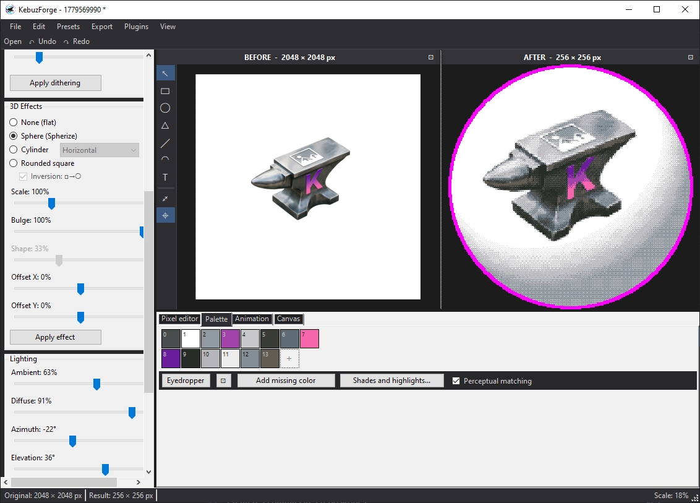

<div align="center">

# KebuzForge

**Pixel art and icons from ordinary pictures, or drawn from scratch.**
Pixelize a picture, pick a palette, wrap it on a sphere, touch up pixels by hand, export PNG, ICO or an animated GIF.

[](#)
[](https://dotnet.microsoft.com/)
[](https://learn.microsoft.com/dotnet/desktop/winforms/)
[](LICENSE)

[English](README.md) | [Русский](README_RU.md)



</div>

---

## Why

Turning a picture into pixel art usually takes a chain of tools: one to scale it down, another to cut the colors, a third to fix pixels by hand, a fourth to build an ICO. KebuzForge keeps the whole chain in one window, and every step stays live: change the size, the palette or the effect, and the result on the right follows, with your hand edits kept on top.

It works the other way round too: draw an icon at a large size from shapes and text on the object canvas and watch the pixel version appear as you draw.

Fully offline: no account, no telemetry. The only network request is a check for a new version on GitHub at startup.

The interface is in English and Russian, switched in the **View** menu.

## What it does

### Object canvas

Build an icon at a large size from rectangles, ellipses, triangles, lines and arcs with arrows, text in any installed font (emoji included) and pictures. The pixel result on the right updates as you draw.

- Move, resize (**Shift** keeps proportions, **Ctrl** scales from the center), rotate with the circle handle, drag the ends of lines and arcs
- Shadows, and a separate color for the overlap of two objects
- Snapping to the center and edges of the canvas and of other objects; **Alt** while dragging inverts it, the toolbar button turns it off
- Groups (**Ctrl+G**, **Ctrl+Shift+G**) move, resize and rotate as one object; copy with Ctrl+drag or **Ctrl+D**; right-click picks an object hidden under another
- An eyedropper next to the fill, stroke and shadow colors picks a color anywhere on the screen
- **Ctrl+wheel** zooms to the cursor, the wheel scrolls, the middle button or **Space** + mouse pans, **Ctrl+0** fits the canvas; shapes and text stay sharp when zoomed in
- Every opened picture becomes a canvas object; drop or paste more pictures onto it

### Pixelization and palettes

- Block averaging or center sampling, aspect ratio lock; very large pictures (over 2048x2048 by area) are scaled down for speed
- **Build palette** picks N colors from the picture as it looks after the 3D effect: flat art keeps its exact colors and small bright accents, photos and noisy scans keep their pure colors instead of washed-out averages
- Retro palettes with the best N colors picked for the picture
- Add a color with the **+** tile, or the one the picture misses most with **Add missing color**; remove one with a right click; recolor a swatch without rebuilding the palette
- **Shades and highlights** grow a small palette with darker and lighter steps and a hue shift, with a live preview
- Perceptual matching of pixels to the palette (CIE94, fewer stray dots on outlines), switchable to plain RGB
- Import and export: JASC PAL, Photoshop ACT, GIMP GPL

### 3D effects and dithering

- Sphere, cylinder and rounded rectangle with lighting: ambient, diffuse, light direction
- Floyd-Steinberg and Bayer 4×4 / 8×8 with adjustable intensity, applied over the effects

### Pixel editor

- Pencil, line, rectangle, ellipse (**Shift** - regular shape, **Ctrl** - from center), fill, eyedropper, eraser, secondary color on right click, zoom up to 16×
- Two layers: right after pixelization (palette, dithering and effects apply over your edits) or the final result (what you draw is what you get)
- Background removal: press **Remove background** and click areas on the result to make them transparent, as many as needed; **Shift**+click removes that color across the whole picture; similar colors are taken by the tolerance, each click can be undone

### Projects

Save everything (canvas, pictures, settings, palette, pixel edits) to one `.kforge` file and open it later as it was. The app asks before closing unsaved work and autosaves every 2 minutes, offering recovery after a crash.

### Animation and export

- Frame-by-frame GIF processing through the whole pipeline, animated GIF export
- PNG, indexed PNG (8 bpp), multi-size ICO, batch processing

### The rest

- **Auto-cascade** - re-pixelizing maps the pixels to the current palette and reapplies dithering and effects, keeping pixel edits and removed areas while the size stays the same (Edit menu, can be turned off); a new palette is built only by **Build palette**
- Outlines, detachable panels, dark, light and hybrid themes, presets, double-click a slider label to type an exact value
- A small link in the status bar when a newer version is out; **×** hides it until the next one
- Plugins, see below

## Install

Grab a file from [Releases](../../releases):

| Download | What it is |
| --- | --- |
| `KebuzForge-Setup-<version>-win-x64.exe` | **Recommended.** Installer: Start menu shortcut, removal through *Apps*, fetches the .NET 8 Desktop Runtime if you do not have it |
| `KebuzForge-win-x64-portable.exe` | One file with everything inside, nothing to install (about 72 MB) |
| `KebuzForge-win-x64-lite.exe` | One file of about 0.6 MB; needs the [.NET 8 Desktop Runtime](https://dotnet.microsoft.com/download/dotnet/8.0) |
| `KebuzForge-win-arm64-...` / `KebuzForge-win-x86-...` | The same for Windows on ARM and 32-bit Windows |
| `FaviconForgePlugin-<version>.zip` | The Favicon Generator plugin |

**Requirements.** Windows 10 or 11.

**SmartScreen.** The files are not signed, so Windows may warn on first start: *More info > Run anyway*.

## Plugins

Plugins are DLLs placed in `%LocalAppData%\Kebuz\KebuzForge\Plugins` (menu **Plugins -> Open plugins folder...**) or in a `Plugins` folder next to the exe.

### Favicon Generator

A complete favicon package for a website, similar to realfavicongenerator.net: favicon.ico and PNG (16/32/48), apple-touch-icon, android-chrome 192/512, PWA maskable, Windows tiles with browserconfig.xml, safari-pinned-tab.svg, site.webmanifest and ready-to-use HTML. Background, padding, rounding and colors per platform, live previews, export to ZIP or a folder.

### Your own plugin

A plugin is a net8.0-windows assembly with a public static class `PluginEntry`:

```csharp
public static class PluginEntry
{
    public static string PluginName => "Plugin name";
    public static string PluginDescription => "Description";
    public static string PluginVersion => "1.0.0";
    public static Form CreateMainForm() => new MyPluginForm();
}
```

## Build from source

.NET 8 SDK required.

```
dotnet build KebuzForge.sln -c Release
```

Single-file publish:

```
dotnet publish KebuzForge.App -c Release -r win-x64 --self-contained true -p:PublishSingleFile=true
dotnet publish KebuzForge.App -c Release -r win-x64 --self-contained false -p:PublishSingleFile=true -p:EnableCompressionInSingleFile=false
```

Installer, needs [Inno Setup 6](https://jrsoftware.org/isinfo.php):

```
iscc installer\setup.iss
```

## Where the data lives

| What | Where |
| --- | --- |
| Settings | `%LOCALAPPDATA%\Kebuz\KebuzForge\settings.json` |
| Presets | `%LOCALAPPDATA%\Kebuz\KebuzForge\presets\` |
| Autosave | `%LOCALAPPDATA%\Kebuz\KebuzForge\autosave\` |
| Plugins | `%LOCALAPPDATA%\Kebuz\KebuzForge\Plugins\`, or `Plugins\` next to the exe |
| Projects | `.kforge` files wherever you save them |

## License

MIT, see [LICENSE](LICENSE).
