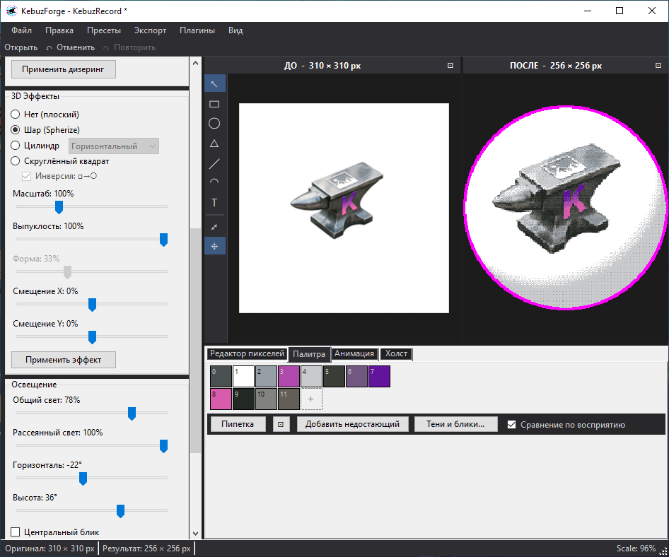

<div align="center">

# KebuzForge

**Пиксель-арт и иконки из обычных картинок или с нуля.**
Пикселизуйте картинку, подберите палитру, натяните её на шар, поправьте пиксели руками и сохраните PNG, ICO или анимированный GIF.

[](#)
[](https://dotnet.microsoft.com/)
[](https://learn.microsoft.com/dotnet/desktop/winforms/)
[](LICENSE)

[English](README.md) | [Русский](README_RU.md)



</div>

---

## Зачем

Чтобы превратить картинку в пиксель-арт, обычно нужна цепочка программ: одна уменьшает, другая сокращает цвета, в третьей правят пиксели руками, в четвёртой собирают ICO. KebuzForge держит всю цепочку в одном окне, и каждый шаг остаётся живым: поменяйте размер, палитру или эффект, и результат справа подстроится, а ручные правки останутся поверх.

Можно и наоборот: нарисовать иконку в большом размере из фигур и текста на холсте и смотреть, как пиксельная версия появляется по ходу рисования.

Полностью без сети: ни аккаунта, ни телеметрии. Единственный запрос в интернет - проверка новой версии на GitHub при запуске.

Интерфейс на русском и английском, переключается в меню **Вид**.

## Что умеет

### Холст из объектов

Иконка собирается в большом размере из прямоугольников, эллипсов, треугольников, линий и дуг со стрелками, текста любым установленным шрифтом (и эмодзи) и картинок. Пиксельный результат справа обновляется по ходу рисования.

- Перемещение, размер (**Shift** - пропорции, **Ctrl** - от центра), поворот кружком, концы линий и дуг
- Тени и отдельный цвет для общей части двух объектов
- Привязка к центру и краям холста и других объектов; **Alt** во время перетаскивания меняет её на обратную, кнопка на панели выключает
- Группы (**Ctrl+G**, **Ctrl+Shift+G**) двигаются, тянутся и поворачиваются как один объект; копия через Ctrl+перетаскивание или **Ctrl+D**; правый щелчок выбирает объект под другим
- Пипетка рядом с цветами заливки, обводки и тени берёт цвет в любом месте экрана
- **Ctrl+колесо** приближает к курсору, колесо листает, средняя кнопка или **пробел** + мышь двигают холст, **Ctrl+0** вписывает его в окно; фигуры и текст при увеличении остаются чёткими
- Каждая открытая картинка становится объектом холста; другие картинки можно перетащить или вставить поверх

### Пикселизация и палитры

- Среднее по блоку или центр блока, сохранение пропорций; очень большие картинки (больше 2048x2048 по площади) уменьшаются для скорости
- **Подобрать палитру** берёт N цветов из картинки в том виде, какой она получается после 3D-эффекта: у плоской графики сохраняются точные цвета и мелкие яркие акценты, у фото и шумных сканов - чистые цвета вместо тусклых средних
- Ретро-палитры с выбором лучших N цветов под картинку
- Цвет добавляется плиткой **+** или кнопкой **Добавить недостающий** (тот, которого картинке больше всего не хватает); удаляется правым щелчком; отдельный цвет можно перекрасить без пересборки палитры
- **Тени и блики** дополняют маленькую палитру более тёмными и светлыми ступенями со сдвигом оттенка, с живым предпросмотром
- Раскладка пикселей по палитре с учётом восприятия (CIE94, меньше случайных точек на контурах), можно переключить на простое сравнение RGB
- Импорт и экспорт: JASC PAL, Photoshop ACT, GIMP GPL

### 3D-эффекты и дизеринг

- Шар, цилиндр и скруглённый прямоугольник с освещением: общий и рассеянный свет, направление
- Floyd-Steinberg и Bayer 4×4 / 8×8 с регулируемой силой, поверх эффектов

### Редактор пикселей

- Карандаш, линия, прямоугольник, эллипс (**Shift** - ровная фигура, **Ctrl** - от центра), заливка, пипетка, ластик, второй цвет на правой кнопке, увеличение до 16×
- Два слоя: сразу после пикселизации (палитра, дизеринг и эффекты ложатся поверх правок) или готовый результат (что нарисовал, то и получил)
- Удаление фона: нажмите **Удалить фон** и щёлкайте по областям результата, чтобы сделать их прозрачными, сколько угодно; похожие соседние цвета берутся по допуску, каждый щелчок отменяется

### Проекты

Всё (холст, картинки, настройки, палитра, ручные правки пикселей) сохраняется в один файл `.kforge` и открывается как было. Перед закрытием несохранённой работы программа спрашивает, а каждые 2 минуты делает автосохранение и после сбоя предлагает восстановить.

### Анимация и экспорт

- Покадровая обработка GIF всем конвейером, экспорт анимированного GIF
- PNG, индексированный PNG (8 bpp), ICO из нескольких размеров, пакетная обработка

### Остальное

- **Авто-каскад** - повторная пикселизация раскладывает пиксели по текущей палитре и заново применяет дизеринг и эффекты, сохраняя ручные правки и удалённые области, пока размер тот же (меню «Правка», отключается); новую палитру строит только **Подобрать палитру**
- Контуры, отсоединяемые панели, тёмная, светлая и гибридная темы, пресеты, двойной щелчок по подписи ползунка для ввода точного значения
- Небольшая ссылка в строке состояния, когда вышла новая версия; **×** прячет её до следующей
- Плагины, см. ниже

## Установка

Файлы лежат в [Releases](../../releases):

| Файл | Что это |
| --- | --- |
| `KebuzForge-Setup-<версия>-win-x64.exe` | **Рекомендуется.** Установщик: ярлык в меню «Пуск», удаление через «Приложения», сам скачивает .NET 8 Desktop Runtime, если его нет |
| `KebuzForge-win-x64-portable.exe` | Один файл, всё внутри, ничего устанавливать не нужно (около 72 МБ) |
| `KebuzForge-win-x64-lite.exe` | Один файл около 0,6 МБ; нужен [.NET 8 Desktop Runtime](https://dotnet.microsoft.com/download/dotnet/8.0) |
| `KebuzForge-win-arm64-...` / `KebuzForge-win-x86-...` | То же для Windows на ARM и 32-битной Windows |
| `FaviconForgePlugin-<версия>.zip` | Плагин Favicon Generator |

**Требования.** Windows 10 или 11.

**SmartScreen.** Файлы не подписаны, поэтому при первом запуске Windows может предупредить: *Подробнее > Выполнить в любом случае*.

## Плагины

Плагины - это DLL в папке `%LocalAppData%\Kebuz\KebuzForge\Plugins` (меню **Плагины -> Открыть папку плагинов...**) или в папке `Plugins` рядом с exe.

### Favicon Generator

Полный набор фавиконок для сайта, как у realfavicongenerator.net: favicon.ico и PNG (16/32/48), apple-touch-icon, android-chrome 192/512, PWA maskable, плитки Windows с browserconfig.xml, safari-pinned-tab.svg, site.webmanifest и готовый HTML. Фон, отступы, скругление и цвета для каждой платформы, живой предпросмотр, экспорт в ZIP или папку.

### Свой плагин

Плагин - это сборка net8.0-windows с публичным статическим классом `PluginEntry`:

```csharp
public static class PluginEntry
{
    public static string PluginName => "Название плагина";
    public static string PluginDescription => "Описание";
    public static string PluginVersion => "1.0.0";
    public static Form CreateMainForm() => new MyPluginForm();
}
```

## Сборка из исходников

Нужен .NET 8 SDK.

```
dotnet build KebuzForge.sln -c Release
```

Публикация одним файлом:

```
dotnet publish KebuzForge.App -c Release -r win-x64 --self-contained true -p:PublishSingleFile=true
dotnet publish KebuzForge.App -c Release -r win-x64 --self-contained false -p:PublishSingleFile=true -p:EnableCompressionInSingleFile=false
```

Установщик, нужен [Inno Setup 6](https://jrsoftware.org/isinfo.php):

```
iscc installer\setup.iss
```

## Где хранятся данные

| Что | Где |
| --- | --- |
| Настройки | `%LOCALAPPDATA%\Kebuz\KebuzForge\settings.json` |
| Пресеты | `%LOCALAPPDATA%\Kebuz\KebuzForge\presets\` |
| Автосохранение | `%LOCALAPPDATA%\Kebuz\KebuzForge\autosave\` |
| Плагины | `%LOCALAPPDATA%\Kebuz\KebuzForge\Plugins\` или `Plugins\` рядом с exe |
| Проекты | файлы `.kforge` там, где вы их сохранили |

## Лицензия

MIT, см. [LICENSE](LICENSE).
